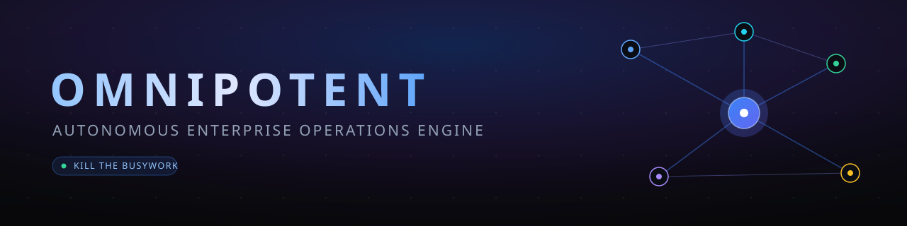
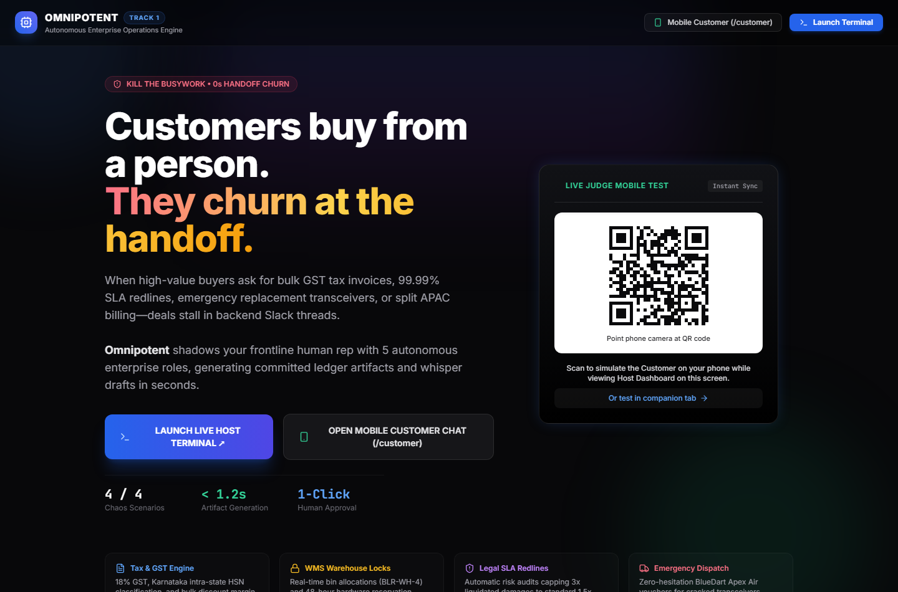
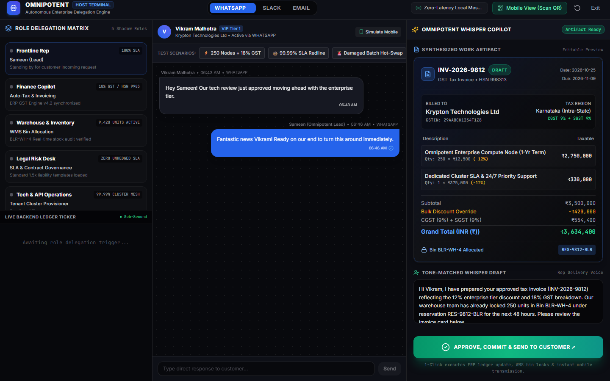
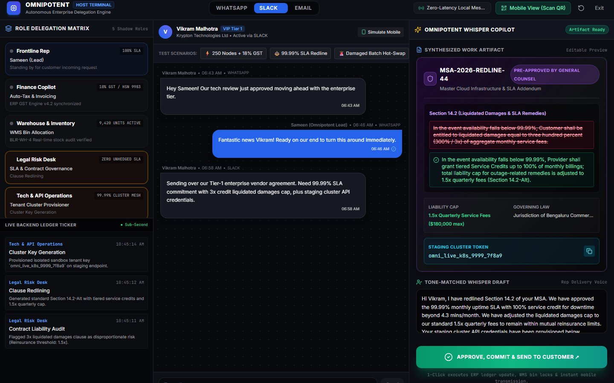
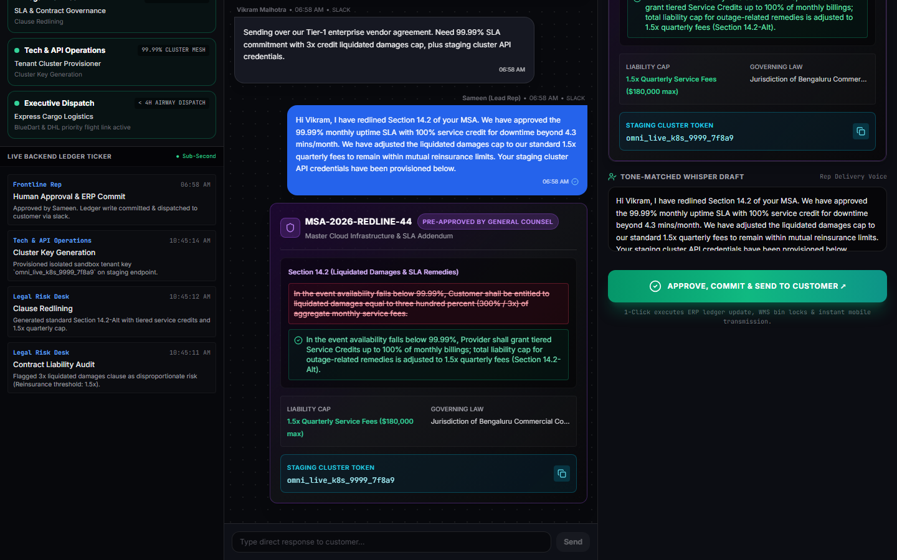
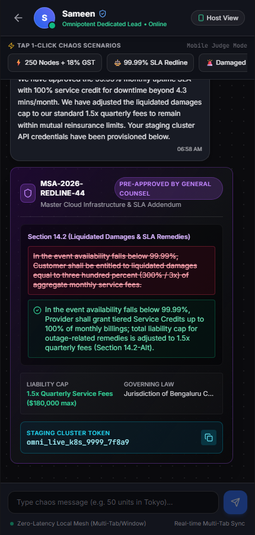

<div align="center">
  

  **DevDay Exchange Community Hackathon: Kochi | Team simply-sameen**

  [](https://react.dev)
  [](https://www.typescriptlang.org)
  [](https://vite.dev)
  [](https://tailwindcss.com)
  [](https://supabase.com)
  [](https://ai.google.dev)
  [](https://omnipotent-ten.vercel.app)
</div>

---

**Live demo:** https://omnipotent-ten.vercel.app

## Problem

Customers buy from a person — they churn at the handoff. When a high-value buyer asks for a bulk GST invoice, a 99.99% SLA redline, or an emergency replacement shipment, the frontline rep stalls while backend teams (finance, warehouse, legal, tech ops, dispatch) process the work in scattered threads. The deal cools off in the gap.

## Solution

Omnipotent shadows a human frontline rep with five autonomous backend roles. A customer message on WhatsApp, Slack, or email is turned into a ready-to-commit work artifact — a GST tax invoice, an SLA clause redline, a dispatch voucher — plus a tone-matched reply draft. The rep reviews everything in a Whisper Copilot panel and commits with one click; the approved artifact lands on the customer's chat in real time.

## How it works

```text
 Customer chat (/customer, mobile or companion tab)
        |  message
        v
 +---------------------------+        +---------------------------+
 |  Shared sync bus          | <----> |  Host terminal            |
 |  BroadcastChannel +       |        |  (?mode=terminal)         |
 |  localStorage, or         |        |                           |
 |  Supabase if configured   |        |  +---------------------+  |
 +---------------------------+        |  | Whisper Copilot     |  |
        |                             |  | - classifies intent |  |
        | execution logs /            |  |   (Gemini key or    |  |
        | artifact preview            |  |   keyword engine)   |  |
        v                             |  | - builds artifact   |  |
 Role Delegation Matrix                |  | - drafts reply      |  |
 frontline / finance /                 |  +---------------------+  |
 inventory / legal / tech / dispatch   |  | APPROVE, COMMIT     |  |
        |                             |  | & SEND (1 click)    |  |
        +-------- approved artifact back to customer chat -------+
```

## Features by milestone

| Milestone | Status |
| --- | --- |
| Dual-interface app: landing, host terminal (`?mode=terminal`), mobile customer view (`/customer`) | Done |
| Real-time sync bus: BroadcastChannel + localStorage mesh across tabs/windows | Done |
| Role Delegation Matrix: 5 backend shadow roles + frontline rep with live status | Done |
| Live backend ledger ticker for execution logs | Done |
| 4 preset chaos scenarios (GST invoice + stock lock, SLA redline + API key, damaged batch hot-swap, split APAC/US billing) | Done |
| Artifact renderer: GST invoice, SLA redline, dispatch voucher, stock reservation cards | Done |
| Whisper Copilot: editable artifact preview + draft reply + 1-click approve/commit/send | Done |
| QR code mobile handoff (landing card + host modal, LAN host override) | Done |
| Gemini AI intent classification (`VITE_GEMINI_API_KEY` or in-app key) | In progress — code path implemented, verified with deterministic keyword fallback, not yet exercised against the live API |
| Supabase cloud sync (`VITE_SUPABASE_URL`/`VITE_SUPABASE_ANON_KEY`) | In progress — code path implemented, not yet verified against a live project |

## Technology stack

- React 18 + TypeScript 5.6, Vite 6 (SPA, client-rendered)
- Tailwind CSS 3.4 (PostCSS + Autoprefixer)
- `qrcode` for the mobile-view QR codes, `lucide-react` for icons
- `@supabase/supabase-js` for optional cloud sync, `@google/genai` for optional AI classification
- Deployed on Vercel via git integration (`vercel.json` included)

Note: `@google/generative-ai` is declared in `package.json` but not imported by the code; `@google/genai` is the SDK actually used.

## Run the project

### Prerequisites

- Node.js and npm — verified with Node v24.14.1 and npm 11.11.0 on Windows.
- No accounts or API keys are required. Every env var is optional (the app falls back to the local mesh and keyword engine).

### Install

```bash
npm install
```

### Environment setup

All variables are optional. Copy `.env.example` to `.env` if you want cloud features:

| Variable | Used for | If unset |
| --- | --- | --- |
| `VITE_SUPABASE_URL` | Supabase project URL | local mesh sync |
| `VITE_SUPABASE_ANON_KEY` | Supabase anon key | local mesh sync |
| `VITE_GEMINI_API_KEY` | Gemini intent classification | keyword-matching engine |

### Start

```bash
npm run dev
```

Open http://localhost:5173 — the landing page links to the Host Terminal and the mobile customer view (`/customer`).

### Demo walkthrough

1. Landing page → **Launch Terminal** (or open `/?mode=terminal`).
2. In the host terminal, tap a scenario pill (e.g. `99.99% SLA Redline`) — the ledger ticker fills and the Whisper Copilot shows the artifact + draft reply.
3. Click **Approve, Commit & Send to Customer** — the rep reply and artifact card appear in the chat stream.
4. Open `/customer` in another tab or scan the QR code — the same stream is synced (same-browser tabs via local mesh).

### Run checks

```bash
npm run build      # tsc && vite build — type check + production build
npm run preview    # serve the production build locally
```

Verified: `npm run build` completes with 0 TypeScript errors; Vite outputs `dist/` (~18 s). There is no test suite or linter configured in this repo — `npm test` and `npm run lint` do not exist.

## Current status

**Working features** — verified by running the app on localhost:5173 (see screenshots):

- Landing page with live QR code for the mobile customer view.
- Host terminal: Role Delegation Matrix, live ledger ticker, customer message stream, platform switcher (WhatsApp/Slack/Email).
- All 4 scenario pills trigger the full pipeline: customer message → execution logs → artifact + whisper draft.
- 1-click Approve, Commit & Send commits the artifact and delivers it to the customer view.
- Cross-view sync between host terminal and `/customer` tab (BroadcastChannel + localStorage).
- Manual messages on both host and customer sides.

**Known limitations:**

- Artifacts and ledger actions are simulated — no real ERP, WMS, carrier, or legal systems are connected; "commit" updates local state only.
- Without Supabase env vars, sync is same-browser only: a phone scanning the QR code on a different device gets its own seeded session, not the host's live state.
- AI classification requires a Gemini key; without one, messages are routed by a keyword-matching fallback, so free-text messages outside the 4 intents default to the GST invoice scenario.

## Screenshots

| | |
| --- | --- |
|  |  |
| Landing page — hero + judge QR card | Host terminal — 3-panel dashboard, GST invoice whisper |
|  |  |
| SLA redline scenario running | After 1-click approve — artifact committed to the stream |
|  | |
| Customer mobile view (`/customer`) — synced artifact | |

## Libraries, APIs, and public datasets used

| Library / API | Use | Source |
| --- | --- | --- |
| React 18 + React DOM | UI | https://react.dev |
| Vite 6 + @vitejs/plugin-react | dev server + build | https://vite.dev |
| TypeScript 5.6 | type checking (`tsc` in build) | https://www.typescriptlang.org |
| Tailwind CSS 3.4, PostCSS, Autoprefixer | styling | https://tailwindcss.com |
| qrcode | QR code canvas generation | https://github.com/soldair/node-qrcode |
| lucide-react | icons | https://lucide.dev |
| @supabase/supabase-js | optional realtime sync backend | https://supabase.com |
| @google/genai | optional Gemini classification (`gemini-2.5-flash`) | https://ai.google.dev |
| Vercel | hosting + git deploys | https://vercel.com |

No public datasets are used. All scenario content is demo data defined in `src/lib/omnipotentEngine.ts`.

## Evaluation

| Metric | Measured result |
| --- | --- |
| Type check (`tsc`) | 0 errors |
| Production build (`vite build`) | 17.97 s |
| JS bundle | 361.95 kB (103.83 kB gzip) |
| CSS bundle | 33.18 kB (6.42 kB gzip) |
| Deployed site | HTTP 200 on https://omnipotent-ten.vercel.app |
| End-to-end scenario latency (message → artifact) | not yet evaluated |
| Supabase sync latency | not yet evaluated |

## Built with Devin

Built during the hackathon with AI pair-programming assistance. The contribution record, review status, and checks are logged in [AI_USAGE.md](AI_USAGE.md); the development timeline is in [CHANGELOG.md](CHANGELOG.md).

## Project structure

```text
index.html                  app shell
vercel.json                 Vercel build config + SPA fallback
docs/banner.svg             README banner
screenshots/                captured app screenshots
src/
  main.tsx                  entry point
  App.tsx                   view routing (landing / host / customer)
  types/index.ts            shared domain types
  lib/
    omnipotentEngine.ts     4 scenario presets, role defaults, Gemini + keyword classifier
    supabase.ts             sync service: Supabase or BroadcastChannel/localStorage mesh
  components/
    LandingView.tsx         landing page + QR card
    HostDashboard.tsx       host terminal (matrix, stream, Whisper Copilot)
    CustomerMobileChat.tsx  mobile customer view
    ArtifactRenderer.tsx    invoice / redline / voucher / reservation cards
    QRCodeModal.tsx         mobile handoff modal
```

## Roadmap

- Verify Gemini live classification and Supabase cloud sync with real credentials; deploy env vars for cross-device sync.
- Replace simulated artifacts with real ERP/WMS/shipping API writes.
- Add a test suite and linter; evaluate end-to-end latency.
- Role-level permissions and audit trail for the approve/commit step.

## Team

| Name | GitHub |
| --- | --- |
| Sameen Sardar | [@simply-sameen](https://github.com/simply-sameen) |

## License

No license file is included in this repository; all rights reserved by the author.
